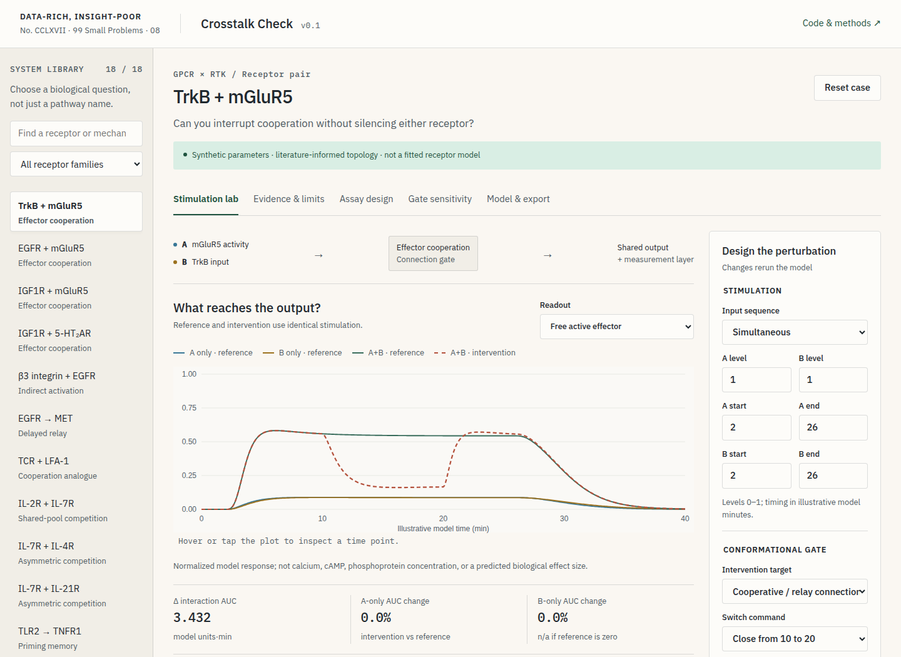

# Crosstalk Check

### Data-Rich, Insight-Poor · No. CCLXVII

99 Small Problems · Installment 08

**Can you interrupt one signaling connection without disabling the rest of the assay?** Crosstalk Check is a local-first stimulation and simulation workbench for exploring that question. It combines 18 literature-linked examples, an interactive browser interface, an independent Python implementation, and explicit controls for measurement artifacts.

This is Installment 08 of the 99 Small Problems series, designated Data-Rich, Insight-Poor · No. CCLXVII, with the framing question: “Is that receptor crosstalk, or did the assay create the interaction?” The repository and interactive tool provide executable, explicitly synthetic examples for that question.



## What it does

- **Compare stimulation histories:** Simultaneous inputs, A before B, B before A, repeated pulses, or custom intervals.
- **Compare intervention targets:** Gate a cooperative/relay connection, gate A's branch or shared-pool allocation, inhibit the whole downstream drive, or remove the gate.
- **Control switch performance:** Change leakage and independent opening/closing time constants.
- **Inspect measurement effects:** Compare the free active effector, a lagging reversible reporter, an irreversible recorder, and a binding sensor that can sequester its target.
- **Keep the factorial controls:** Automatically solve neither input, A, B, and A+B under both reference and intervention conditions.
- **Explore sensitivity:** Run a 25-condition gate-leak/closing-time sweep.
- **Reproduce the result:** Export all state trajectories as CSV, the main chart as SVG, and a Python-compatible configuration as JSON.
- **Draft a bioassay design:** Export a case-specific experimental brief and a seeded, randomized 96-well layout with matched factorial conditions and optional unsimulated technical controls.

## What it does not do

**All numerical parameters are illustrative, not experimentally fitted.** These are mechanism-class forward models, not 18 separately calibrated receptor models. The model does not predict drug potency, therapeutic efficacy, clinical response, protein sequence performance, calcium oscillations, or receptor structures.

The browser marks each example as a receptor pair, an engineered comparator, or a proposed extension. Evidence, model mapping, omissions, and the proposed switch are stated separately for every example. A topology can be motivated by an experiment without its simulated time course reproducing that experiment.

## Open the tool

The browser application is static and requires no build, login, server-side API, or credentials. From the repository root:

```bash
python -m http.server 8000 --directory web
```

Open `http://localhost:8000` in a browser. The page must be served over HTTP rather than opened as a `file://` URL because it loads local JSON modules.

Calculations run in the page. No simulation inputs are uploaded; optional font files are fetched from Google Fonts, with a local font fallback.

## Run the Python model

Use Python 3.11 or newer. A virtual environment is recommended:

```bash
python -m venv .venv
source .venv/bin/activate
python -m pip install -e ".[test]"

python -m crosstalk.cli run \
  --config examples/coincidence.json \
  --output results/custom

python -m crosstalk.cli demo --output results/demo
```

On Windows, activate with `.venv\Scripts\activate`. The installed `crosstalk` command is an equivalent entry point.

```python
from crosstalk import Parameters, Protocol, Segment, Signal, simulate

stimulus = Signal(segments=(Segment(2, 26, 1),))
gate = Signal(baseline=1, segments=(Segment(10, 20, 0),))
result = simulate(
    Parameters(gate_mode="edge", cooperation=3),
    Protocol(a=stimulus, b=stimulus, switch=gate),
)
print(result.summary())
```

## Example library

There are 13 receptor-pair examples and five engineered comparators or proposed extensions. The first group spans GPCR–RTK cooperation, integrin–RTK signaling, delayed RTK relays, immune/adhesion integration, cytokine-receptor competition, innate priming, and cross-tolerance.

| Example group | Included systems | Interpretation |
|---|---|---|
| GPCR × RTK | TrkB–mGluR5, EGFR–mGluR5, IGF1R–mGluR5, IGF1R–5-HT₂AR | Shared-effector cooperation motifs motivated by the [RTK/GPCR crosstalk study](https://www.cell.com/cell-reports/fulltext/S2211-1247(23)01607-8). |
| Adhesion and immune receptors | β3 integrin–EGFR, TCR–LFA-1 | Indirect activation and cooperation analogues, not mechanical or spatial reconstructions ([integrin–EGFR study](https://pmc.ncbi.nlm.nih.gov/articles/PMC3216655/); [Ras-LOCKR study](https://pmc.ncbi.nlm.nih.gov/articles/PMC11631767/)). |
| RTK × RTK | EGFR → MET | Delayed-relay analogue; no claim of direct receptor cross-phosphorylation or fitted hours-scale kinetics ([Breindel et al.](https://pmc.ncbi.nlm.nih.gov/articles/PMC3745527/)). |
| Cytokine receptors | IL-2R–IL-7R, IL-7R–IL-4R, IL-7R–IL-21R | Finite shared-pool competition, with the preassembly interpretation explicitly separated from direct measurements ([Cotari et al.](https://pmc.ncbi.nlm.nih.gov/articles/PMC3896501/); [Gonnord et al.](https://www.science.org/doi/10.1126/scisignal.aal1253)). |
| Innate signaling | TLR2 → TNFR1, TNFR → TLR4, Notch–TLR | Priming, tolerance, and feedback analogues, not fitted transcriptional networks ([TLR2/TNF study](https://pmc.ncbi.nlm.nih.gov/articles/PMC4124019/); [TNF tolerance study](https://www.nature.com/articles/ni.2043); [Notch/TLR study](https://pmc.ncbi.nlm.nih.gov/articles/PMC2585039/)). |
| Engineered comparators | FGFR/SOS entry points; β2AR with Gαi-actuator history | These are not pairs of native receptors ([OptoFGFR/OptoSOS study](https://pmc.ncbi.nlm.nih.gov/articles/PMC9189677/); [LOV2GIVe study](https://pmc.ncbi.nlm.nih.gov/articles/PMC7515630/)). |
| Proposed de novo extensions | IL-7R geometry; TLR3 valency; D1R exoframe modulation | Context axes are not second receptors; the dynamic-switch applications remain proposals ([geometry preprint](https://pmc.ncbi.nlm.nih.gov/articles/PMC12632830/); [TLR3 study](https://www.nature.com/articles/s41467-025-56369-w); [GEM study](https://www.nature.com/articles/s41586-025-09957-1)). |

The machine-readable library is `web/cases.json`. The source, evidence statement, model mapping, limitations, and suggested discriminating assay are attached to each record.

## Mathematical and scientific documentation

- `docs/MODEL.md`: Equations, capacities, state definitions, intervention semantics, and numerical methods.
- `docs/LITERATURE_SYNTHESIS.md`: The accompanying mechanistic literature synthesis and proposed conformational-switch assay concepts.
- `docs/SERIES_NOTE.md`: The editorial framing for Data-Rich, Insight-Poor.
- `docs/QA.md`: Browser-flow inventory and verification record.
- `results/demo/RESULTS.md`: Reproducible synthetic results, with parameter and software manifests.

## Verification

```bash
python -m pytest
python scripts/build_reference.py
node --test tests/browser-engine.test.mjs
```

Python tests cover analytical solutions, input discontinuities, capacity conservation, isolated pathways, transactivation, shared-pool release, sensor perturbation, priming/tolerance signs, numerical convergence, and every example. Browser-engine tests compare every case against SciPy DOP853 fixtures with a maximum permitted absolute state error of \(2\times10^{-5}\).

The browser uses RK4 with a parameter-dependent step bound and splits integration at input discontinuities. Neither implementation clips invalid trajectories to conceal an error. Numerical verification establishes consistency with the equations, not biological validation.

Automated UI tests can also be run:

```bash
npm ci
npx playwright install chromium
npm run test:ui
```

## First experiment to try

Open TrkB + mGluR5 and compare the connection gate with the whole-effector gate. Inspect the A-only and B-only AUC changes, not just the reduction in the combined response.

Next, choose an IL-7 competition example and compare the connection gate with the A-allocation gate. A gate acting on a connection absent from the model can correctly do nothing; that is an informative control rather than a failed visualization.

Finally, increase reporter lag or sensor loading. Ask whether a persistent trace means persistent signaling, and whether adding a reader changed the free signal.

## Scope and release

This repository contains original model code and original analytical writing, with links to external literature rather than copies of third-party manuscripts. Evidence was reviewed through October 29, 2026; source access limitations are identified in the synthesis and individual examples.

The original code and accompanying original documentation are released under the [MIT license](LICENSE). Linked third-party literature and externally served fonts retain their own terms; the repository's license does not relicense those materials.

Research-use descriptions state the intended scientific scope and lack of clinical validation. They do not impose additional restrictions on the MIT license.

The assigned editorial identity is Data-Rich, Insight-Poor · No. CCLXVII / 99 Small Problems · Installment 08. Public availability and an open-source license do not imply experimental validation, a DOI, or suitability for regulated decisions.
