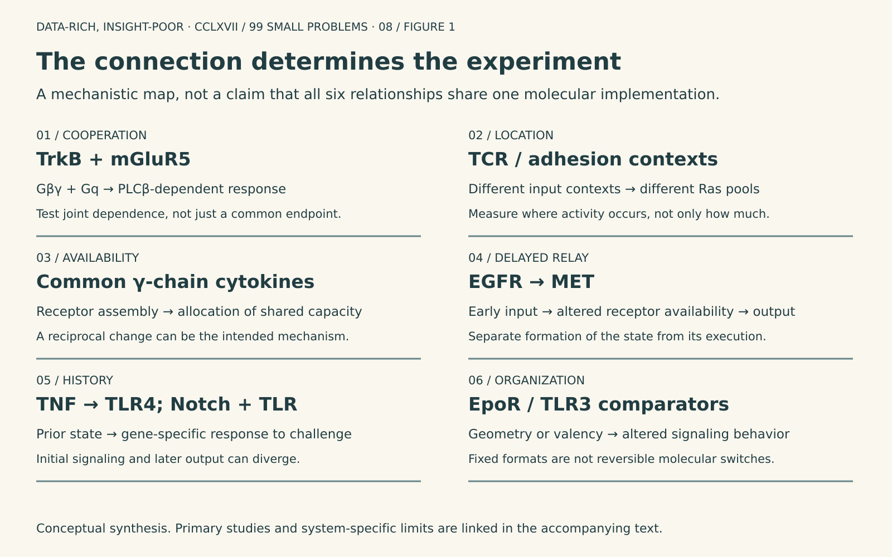
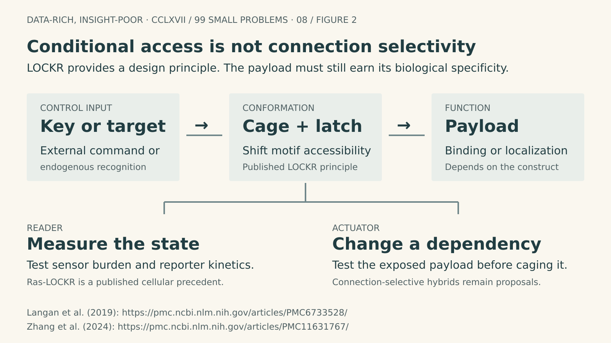
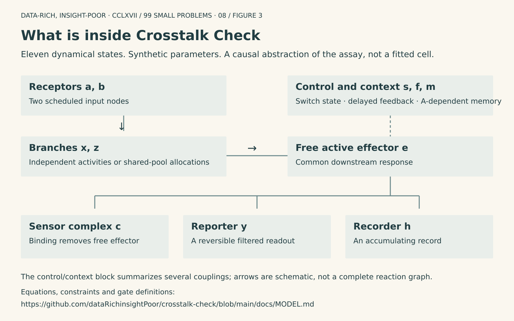
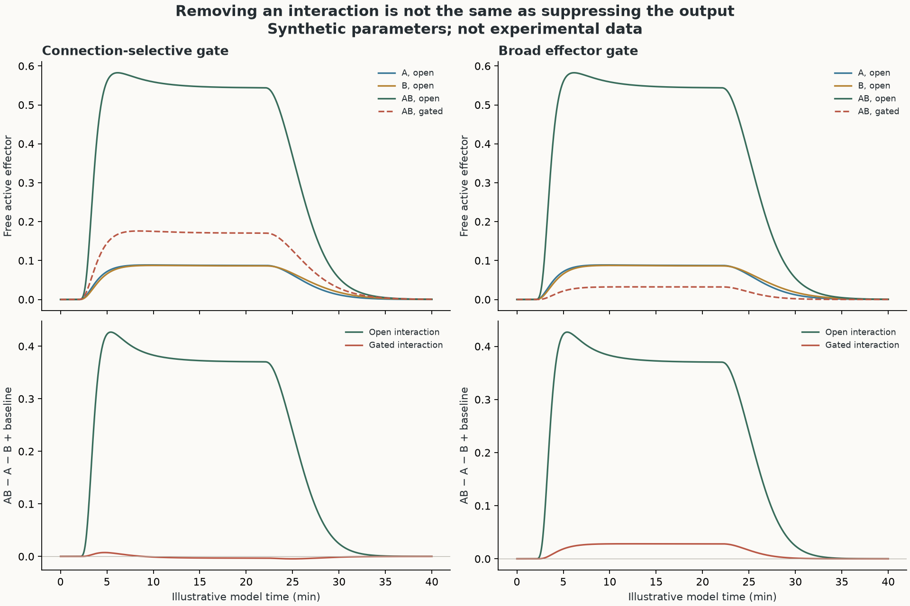
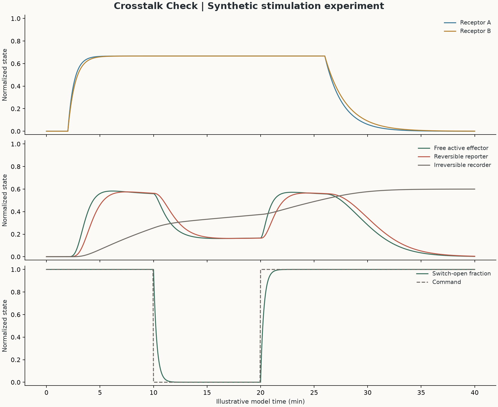
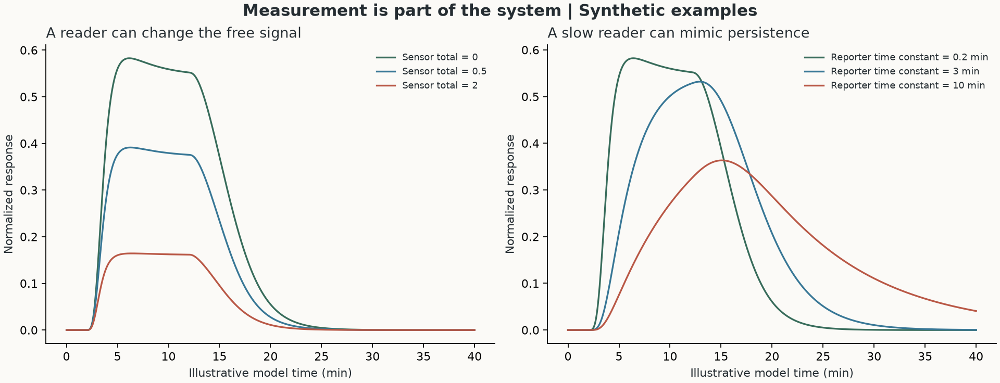

# Interrupt the Connection, Not the Cell

Data-Rich, Insight-Poor · No. CCLXVII  
99 Small Problems · Installment 08  
Ermelinda Damko

A receptor can be necessary for a response without binding the ligand that initiated it. In the TrkB–mGluR5 system, BDNF-driven calcium signaling can depend on the constitutive activity of a glutamate receptor even when glutamate binding and receptor heteromerization are not required for the observed cooperation ([Lao-Peregrin et al., Cell Reports](https://pmc.ncbi.nlm.nih.gov/articles/PMC10844890/)). An assay organized around one ligand, one receptor, and one downstream signal would have difficulty representing that dependency. It might classify mGluR5 as background, interpret an mGluR5 inhibitor as interference, or attribute the entire response to TrkB because BDNF was the reagent added to the well.

The interpretation becomes more demanding when the same receptor relationship changes what the cell can respond to next. A recent study distinguishes amplification of BDNF–TrkB signaling by mGluR5 from TrkB-driven internalization of mGluR5, linking these processes to different forms of synaptic plasticity in preclinical models ([Arefin et al., Science Advances](https://www.science.org/doi/10.1126/sciadv.aec1444)). The immediate response and the subsequent response capacity are therefore different biological quantities. A larger signal now can coexist with reduced access to another signal later.

This is where pathway complexity becomes an assay-design problem rather than a diagramming problem. A measurement may be reproducible, precise, and dose responsive while remaining ambiguous about which dependency generated it. Increasing the number of endpoints does not necessarily resolve that ambiguity; it can produce several accurate measurements of the same shared bottleneck.

The useful ambition is not to eliminate crosstalk. It is to determine which connection matters, when it matters, and what else changes when it is interrupted. Conformational protein switches offer a way to make that question experimentally sharper, provided that conditional activity is not mistaken for molecular selectivity. The accompanying [Crosstalk Check workbench](https://datarichinsightpoor.github.io/crosstalk-check/) makes the corresponding experimental assumptions inspectable: stimulation order, switch leakage, opening and closing kinetics, shared capacity, feedback, and the measurement process itself.

The [public code](https://github.com/dataRichinsightPoor/crosstalk-check), [model equations](https://github.com/dataRichinsightPoor/crosstalk-check/blob/main/docs/MODEL.md), and [eighteen-project development guide](https://github.com/dataRichinsightPoor/crosstalk-check/blob/main/docs/PROJECT_GUIDE.md) are available under an [MIT license](https://github.com/dataRichinsightPoor/crosstalk-check/blob/main/LICENSE). The numerical parameters are synthetic, not fitted receptor kinetics. The purpose is to improve the next experiment, not to imply that a simulated connection already has a validated protein switch.

## What a shared signal conceals

Calling two pathways “connected” leaves the causal relationship unspecified. One input may supply an essential biochemical partner; another may redistribute a limiting receptor subunit, alter the location of an active effector, or leave a transcriptional state that changes a later response. These are experimentally distinct relationships, represented by the TrkB–mGluR5, common-γ-chain, compartmentalized Ras, and TNF-tolerance studies discussed below ([Lao-Peregrin et al.](https://pmc.ncbi.nlm.nih.gov/articles/PMC10844890/); [Gonnord et al.](https://www.science.org/doi/10.1126/scisignal.aal1253); [Zhang et al.](https://pmc.ncbi.nlm.nih.gov/articles/PMC11631767/); [Park et al.](https://pmc.ncbi.nlm.nih.gov/articles/PMC3258532/)).

The distinction changes what would count as selective control. In a cooperative circuit, preserving the individual responses while removing the joint excess can be informative. In a competitive circuit, relieving one dependency is expected to redistribute signaling capacity, so a change in an individual response may be the intended mechanism rather than evidence of nonspecificity. In a memory-bearing circuit, an intervention delivered after the state has formed may leave the later phenotype intact even if it completely blocks the initiating connection.

An assay should therefore begin with a causal contrast, not a favored reporter. What alternative explanation should become less plausible if the experiment succeeds? Which measurement would distinguish that explanation from simple loss of viability, receptor depletion, broad pathway inhibition, or altered sensor occupancy?

Figure 1. Different forms of crosstalk require different causal comparisons. This conceptual synthesis draws on studies of [cooperation](https://pmc.ncbi.nlm.nih.gov/articles/PMC10844890/), [location](https://pmc.ncbi.nlm.nih.gov/articles/PMC11631767/), [shared capacity](https://www.science.org/doi/10.1126/scisignal.aal1253), [delayed relays](https://pmc.ncbi.nlm.nih.gov/articles/PMC3745527/), [history](https://pmc.ncbi.nlm.nih.gov/articles/PMC3258532/), and [receptor geometry](https://pmc.ncbi.nlm.nih.gov/articles/PMC4766813/). It is not a literal molecular pathway diagram or evidence that one switch architecture applies to every system.

### Cooperation at an effector: GPCRs and receptor tyrosine kinases

TrkB–mGluR5 provides a particularly useful starting point because the receptor classes do not map neatly onto independent intracellular routes. Lao-Peregrin and colleagues found that noncanonical G-protein activation downstream of TrkB supplies Gβγ, while constitutive Gq activity associated with mGluR5 contributes to a PLCβ-dependent calcium response ([Lao-Peregrin et al.](https://pmc.ncbi.nlm.nih.gov/articles/PMC10844890/)). The study supported calcium oscillations and synaptic consequences, not merely an increase in a generic endpoint, and the tested cooperation did not require glutamate binding or receptor heteromerization ([Lao-Peregrin et al.](https://pmc.ncbi.nlm.nih.gov/articles/PMC10844890/)).

This is not equivalent to demonstrating that the receptors form a physical signaling complex. It establishes a functional dependency at a point of convergence, with specific biochemical evidence for the contributing routes ([Lao-Peregrin et al.](https://pmc.ncbi.nlm.nih.gov/articles/PMC10844890/)). For bioassay development, the immediate consequence is that receptor expression, basal coupling, and the state of the shared effector become part of the assay mechanism rather than merely attributes of the cell line.

The same paper examined EGFR–mGluR5, IGF1R–mGluR5, and IGF1R–5-HT2A combinations, supporting a broader possibility of RTK–Gq-linked receptor cooperation without establishing that every pair shares an identical quantitative mechanism ([Lao-Peregrin et al.](https://pmc.ncbi.nlm.nih.gov/articles/PMC10844890/)). These are four related projects, not four interchangeable parameter labels. I would require each pair to establish its own proximal RTK response, GPCR-linked contribution, and joint dependence before transferring a switch design from one to another.

A concrete engineering foothold already exists in that work: GBAi, an engineered Gαi-based inhibitor of noncanonical G-protein activation, was used to interrogate the TrkB contribution, with an inactive comparator and tests of pathway discrimination ([Lao-Peregrin et al.](https://pmc.ncbi.nlm.nih.gov/articles/PMC10844890/)). Making such an intervention conditional is a more specific proposal than asking for a universal “crosstalk blocker.” It is still a proposal: a folded inhibitory protein is not automatically a suitable LOCKR latch cargo, and conditional recruitment or localization may be more realistic than trying to cage its entire binding surface.

The stimulation experiment should separate BDNF alone, the GPCR-directed condition alone, their combination, and baseline, with the intervention applied before activation or after the joint response has begun. A calcium readout should be paired with proximal signaling and, where relevant, spatially resolved Ras or ERK measurements. If the experimental claim concerns oscillations, single-cell temporal data are indispensable; the current model does not generate calcium oscillations and cannot validate frequency coding.

The meaning of the second “input” needs particular care here. If the GPCR contribution is constitutive, the relevant comparison may be a functional versus disabled GPCR background, not addition versus omission of a second ligand. A simulated B pulse must not be interpreted as evidence that glutamate stimulation is required for the TrkB effect. The experimental factor has to represent the dependency being tested.

The 2026 follow-up makes the endpoint problem more consequential. Arefin and colleagues found that ketamine pretreatment increased surface TrkB and facilitated BDNF responsiveness, while TrkB activation promoted mGluR5 endocytosis and reduced subsequent mGluR-dependent depression in the tested systems ([Arefin et al.](https://www.science.org/doi/10.1126/sciadv.aec1444)). Their experiments did not support acute ketamine activation of TrkB in the calcium and ERK assays, and the work does not establish a general human therapeutic mechanism ([Arefin et al.](https://www.science.org/doi/10.1126/sciadv.aec1444)). A useful switch experiment would distinguish the initial signaling window from the later trafficking window, measuring surface receptor abundance as well as function. That trafficking mechanism is outside the present simulator.

### Adhesion and compartment: when the same effector is not the same signal

In the β3-integrin–EGFR example, adhesion is not a neutral support condition. In the studied mammary epithelial and carcinoma systems, β3-integrin-associated Src activity linked adhesion to EGFR phosphorylation, p190RhoGAP signaling, and suppression of RhoA; the authors distinguished this adhesion-associated route from soluble EGF-driven signaling ([Balanis et al., Molecular Biology of the Cell](https://pmc.ncbi.nlm.nih.gov/articles/PMC3216655/)). The important variable is therefore not simply whether EGFR is phosphorylated, but how that phosphorylation is connected to adhesion and cytoskeletal organization.

A local recruitment switch could be useful here if an accessible competitor or regulatory module first demonstrates the required discrimination. The decisive comparison would hold adhesion conditions constant while testing whether the adhesion-linked EGFR–p190RhoGAP response can be altered without broadly suppressing soluble EGF signaling. Cell attachment, spreading, morphology, surface EGFR, and Src activity would be explanatory measurements, not optional housekeeping. A construct that changes cell shape may change the signaling experiment before it ever reaches the proposed molecular connection.

The TCR example adds a different kind of localization problem. Ras-LOCKR detected predominantly Golgi Ras activity in Jurkat cells under CD3/CD28 stimulation and plasma-membrane Ras activity under CD3/ICAM1 conditions ([Zhang et al., Nature Biotechnology](https://pmc.ncbi.nlm.nih.gov/articles/PMC11631767/)). Because those conditions also differ in costimulatory context, the comparison should not be retold as an isolated LFA-1 perturbation with every other input held constant.

The result nonetheless changes the assay question. Whole-cell Ras activity could obscure a redistribution between compartments, while a downstream ERK response alone would not identify which Ras pool contributed. A realistic first project is therefore reader-first: establish compartment-resolved Ras behavior under carefully matched stimulation, quantify expression dependence of the sensor, and only then consider a localized actuator. The generic “TCR + LFA-1” example in the workbench is a prompt for that design problem, not a quantitative reconstruction of an immunological synapse.

### Delayed receptor relays: EGFR and MET

A delayed relay can look like receptor transactivation while being sustained by a change in receptor availability. Breindel and colleagues described EGFR-dependent, MAPK-associated stabilization and delayed activation of MET in non-small-cell lung cancer models ([Breindel et al., Cancer Research](https://pmc.ncbi.nlm.nih.gov/articles/PMC3745527/)). The observation supports an EGFR-to-MET dependency in those systems; it does not, by itself, establish immediate physical transmission between the two receptors.

The useful stimulation design is sequential. Give the EGFR input, remove or terminate that input as experimentally appropriate, and measure total MET, phospho-MET, and a functional output across the interval in which the delayed response develops. Compare an intervention restricted to the initial window with one delivered after the relay has formed. If only the early intervention prevents the later response, the result is consistent with blocking formation of the permissive state; it is not equivalent to directly inhibiting active MET.

A conditional localization tool might eventually distinguish establishment from execution, but a broad MAPK inhibitor would remain a poor proof of connection selectivity. In the simulator, a lagged transactivation term provides a useful abstraction for asking when to sample. It does not implement MET synthesis, degradation, trafficking, or phosphosite chemistry, and a simulated delay should not be assigned a biological half-life without independent measurements.

### Shared receptor components: the cytokine response as an allocation problem

The common γ-chain systems reveal why receptor specificity and signaling independence are different properties. Cotari and colleagues combined single-cell measurements and modeling to show that IL-2Rα abundance influences responses to IL-2 and to other γ-chain cytokines, with a receptor-preassembly model accounting for an inverse relationship with IL-7 sensitivity ([Cotari et al., Science Signaling](https://pmc.ncbi.nlm.nih.gov/articles/PMC3896501/)). The model was consistent with the observations; it should not be described as a complete structural demonstration of every receptor assembly state.

Gonnord and colleagues provided more direct evidence that IL-7 can limit IL-4 and IL-21 responses by using shared γ-chain, distinguishing this mechanism from receptor internalization, canonical JAK/STAT feedback, and SOCS-dependent explanations in their tested context ([Gonnord et al., Science Signaling](https://www.science.org/doi/10.1126/scisignal.aal1253)). A cytokine can therefore inhibit another response without acting as that receptor’s antagonist. It can change which receptor complexes are available to assemble.

The ordering was asymmetric: IL-7 preexposure reduced later IL-4 and IL-21 responses, whereas the reverse preexposures did not equivalently suppress IL-7, consistent with a hierarchy of receptor–γ-chain interactions ([Gonnord et al.](https://www.science.org/doi/10.1126/scisignal.aal1253)). That asymmetry is a more discriminating target for an assay than a generic negative interaction score. It asks the model to explain which receptor gains access to the limiting component and under what prior conditions.

This is a different use case for a switch. The desired intervention might redistribute a component rather than abolish an interaction term, and the interpretation must allow for reciprocal changes in the two cytokine responses. Preserving IL-7 signaling completely while increasing IL-4 signaling may be impossible under a particular resource constraint; demanding that outcome as the universal definition of specificity would exclude the mechanism under investigation.

For IL-2/IL-7, I would first stratify cells by relevant receptor-subunit abundance and compare proximal signaling with pSTAT5, rather than relying on a population-average potency curve. For IL-7/IL-4 and IL-7/IL-21, I would compare simultaneous stimulation with both orders of addition, including recovery after removal of the first input, and measure the appropriate STAT responses alongside surface receptor components. An apparent potency change should be interpreted in relation to expression and available signaling capacity, not automatically as a change in ligand affinity.

A γ-chain-targeting actuator is not currently a plug-and-play proposal. Directly constraining the shared subunit could perturb several cytokine receptors and alter trafficking. The practical first task is to establish that the resource model explains the experimental contrast and to identify a controllable assembly or localization step with a tolerable off-state. The model’s allocation gate is useful precisely because it exposes the consequences of such an assumption before a difficult construct is built; its normalized resource variable is not a stoichiometric reconstruction of γ-chain receptor complexes.

### Innate signaling: priming, tolerance, and promoter-specific consequences

Sequential stimulation is especially informative when the first receptor changes the machinery used by the second. In a TLR2–TNFR1 study, TLR2 stimulation altered the localization of MAL and TRADD, and MAL facilitated TNFR1-dependent TRAF6-associated signaling and IL-6 production; the relationship was not reproduced simply by substituting TLR4 stimulation ([Chang et al., Journal of Cellular and Molecular Medicine](https://pmc.ncbi.nlm.nih.gov/articles/PMC4124019/)). This is a localized adaptor problem, not evidence for a universal physical TLR–TNFR complex.

The relevant intervention would test whether that priming-dependent adaptor route can be interrupted while preserving enough independent TLR2 and TNFR1 function to interpret the result. A local competitor is worth considering only after its uncaged form demonstrates such discrimination. The experiment should include TLR2 followed by TNF, simultaneous stimulation, the reverse order, and an appropriate receptor comparator. An IL-6 endpoint should be paired with earlier signaling or localization measurements, because altered secretion alone would not identify the disrupted step.

TNF-to-TLR4 tolerance illustrates why the intervention window can be more informative than the endpoint amplitude. Park and colleagues found that TNF pretreatment of human macrophages required approximately 24 hours to substantially reduce the later IL-6 response to LPS, with GSK3-associated restriction of chromatin accessibility at the IL6 locus ([Park et al., Nature Immunology](https://pmc.ncbi.nlm.nih.gov/articles/PMC3258532/)). Initial IκBα degradation after LPS was nearly intact in tolerized cells, while rapid reaccumulation and promoter-level effects helped constrain later output ([Park et al.](https://pmc.ncbi.nlm.nih.gov/articles/PMC3258532/)).

A late low-IL-6 measurement therefore cannot be interpreted as simple failure of TLR4 activation. I would distinguish an intervention present only during TNF pretreatment from one delivered only at LPS challenge, then compare early NF-κB dynamics, transcriptional output, and cell state. The original study did not separately settle every induction-versus-maintenance question, so a proposed reversible switch should be used to test that distinction rather than to assume it away. The simulator’s inhibitory memory term is a deliberately compressed hypothesis, not a chromatin model, and its illustrative time axis must not be mistaken for the experimental 24-hour protocol.

Notch–TLR cooperation adds promoter specificity. Hu and colleagues found that basal Notch/RBP-J activity contributed to induction of selected TLR-responsive genes, while Notch-linked HES1 and HEY1 feedback constrained IL-6 and IL-12 expression ([Hu et al., Immunity](https://pmc.ncbi.nlm.nih.gov/articles/PMC2585039/)). The mechanism involved cooperation with a pre-existing transcriptional state, not simply acute TLR-triggered Notch receptor cleavage ([Hu et al.](https://pmc.ncbi.nlm.nih.gov/articles/PMC2585039/)).

Here, a single NF-κB reporter is an inadequate stand-in for the claim. A switch proposed to alter NICD/RBP-J access or a related regulatory interaction should be tested against multiple native transcripts, with attention to when the regulatory state is established. The desired outcome may be a change in the composition of an inflammatory response rather than a uniform decrease in every inflammatory measurement.

### Geometry and input position: comparisons that prevent the wrong generalization

The remaining workbench examples are comparators and development extensions, not additional validated receptor-pair switches. Their value is to test whether an apparently transferable control strategy depends on geometry, entry point, or prior signaling history. Treating them as demonstrations of the same engineered mechanism would erase the distinction the assay is meant to resolve.

Moraga and colleagues showed that surrogate ligands could alter EpoR signaling through different receptor dimer geometries, demonstrating that extracellular organization can change downstream behavior rather than merely tune binding strength ([Moraga et al., Cell](https://pmc.ncbi.nlm.nih.gov/articles/PMC4766813/)). Coventry and colleagues showed that the format and valency of designed TLR3 binders could produce different functional outcomes, including agonism with selected multivalent constructs ([Coventry et al., Nature Communications](https://www.nature.com/articles/s41467-025-56369-w)). Neither result establishes a reversible geometric transition within one receptor-bound designed protein.

For the IL-7R geometry extension, I would compare fixed formats before introducing a conformational hinge. The IL-7R-specific anchor currently linked in the workbench is a preprint, so it is not used here as peer-reviewed validation; the EpoR paper establishes the broader principle, not an IL-7R result. For TLR3, a valency effect should be separated from changes in avidity, clustering, uptake, and access to the signaling compartment. A high transcriptional reporter signal alone cannot identify which of those changes was responsible.

D1R exoframe modulators extend the design space to proteins that engage a GPCR’s transmembrane region and alter its pharmacology ([“De novo design of GPCR exoframe modulators,” Nature](https://www.nature.com/articles/s41586-025-09957-1)). This is evidence that designed proteins can alter receptor behavior, not evidence that the reported modulators already provide an externally commanded, reversible switch. A reasonable development sequence is to characterize the modulator’s baseline pharmacology and expression dependence before adding conditional access or recruitment.

The FGFR/SOS comparator and the β2AR/Gαi history example address different questions. Optogenetic actuator–ERK biosensor experiments showed that entering the MAPK pathway at receptor level or at SOS exposes different feedback structure ([Dessauges et al., Molecular Systems Biology](https://pmc.ncbi.nlm.nih.gov/articles/PMC9189677/)). LOV2GIVe, a natural-domain hybrid rather than a de novo switch, enabled temporally controlled Gαi regulation and tests of how prior Gαi activity changes later β-adrenergic cAMP responses ([Garcia-Marcos, eLife](https://pmc.ncbi.nlm.nih.gov/articles/PMC7515630/)). These examples argue for comparing where the input enters and what happened before stimulation, not merely matching the final response amplitude.

## What protein design contributes, and what it does not

The relevant advance in de novo design is the ability to engineer a relationship between molecular recognition and a change in function. LOCKR uses a designed cage–latch equilibrium in which a key exposes a functional motif; the original demonstrations included conditional binding, degradation, and localization in specific biochemical and cellular implementations ([Langan et al., Nature](https://pmc.ncbi.nlm.nih.gov/articles/PMC6733528/)). Those results support motif accessibility as a design principle. They do not establish that an arbitrary folded signaling domain can be hidden in a latch and retain low background, useful kinetics, and predictable reset.

The design problem is therefore more demanding than stabilizing one favorable bound structure. A switch must balance alternative states and couple recognition to a useful change in their populations, as the LOCKR and two-state hinge studies explicitly address ([Langan et al.](https://pmc.ncbi.nlm.nih.gov/articles/PMC6733528/); [Praetorius et al.](https://pmc.ncbi.nlm.nih.gov/articles/PMC10697137/)). For an assay, low leakage, strong activation, rapid disengagement, and adequate intracellular concentration should be measured as separate properties rather than collapsed into one “dynamic range.” A design that suppresses background by making activation difficult may fail at achievable cellular exposure; one that binds its command persistently may be useful for recording but poorly suited to testing a short causal window.

For an assay actuator, the payload should earn its specificity before it is made conditional. An uncaged competitor that broadly disrupts G proteins, membrane trafficking, or a shared transcriptional regulator will not become connection-selective merely because its exposure is inducible. I would first establish the accessible payload’s concentration-response behavior, localization, binding-defective control, and effects on the independent pathways. Only then would I compare caging with conditional recruitment, relocalization, or assembly.

For a reader, the dependency runs in the other direction: the biological state controls the switch. Ras-LOCKR couples Ras recognition to a designed conformational change and FRET reporting, providing a published route to endogenous, spatially resolved Ras measurements ([Zhang et al.](https://pmc.ncbi.nlm.nih.gov/articles/PMC11631767/)). An endogenous-state sensor is not an independent causal intervention, however. It may report a pathway accurately while also binding enough target to perturb the process being measured.

Figure 2. Conditional access does not confer connection selectivity. The published LOCKR and Ras-LOCKR foundations support different uses of designed conformational coupling, while the receptor-specific actuator routes proposed here still require validation ([Langan et al.](https://pmc.ncbi.nlm.nih.gov/articles/PMC6733528/); [Zhang et al.](https://pmc.ncbi.nlm.nih.gov/articles/PMC11631767/)).

For a simple equilibrium interaction, sensor occupancy illustrates the concern:

\[
f_{\mathrm{bound}}\approx\frac{[S]_{\mathrm{free}}}{K_d+[S]_{\mathrm{free}}},\qquad K_d=\frac{k_{\mathrm{off}}}{k_{\mathrm{on}}}.
\]

This is a diagnostic relation, not a quantitative description of every cellular biosensor. Increasing sensor abundance can improve detection while increasing target occupancy; changing affinity can alter both reporting and dissociation. A sensible expression-titration experiment asks whether the biological response changes as the sensor becomes easier to measure. An orthogonal endpoint helps, but absence of a detectable effect in one downstream readout does not establish universal nonperturbation.

Kinase-responsive LOCKR variants show why molecular reset and measurement reset must also be separated. Woodall and colleagues demonstrated conditional ITAM phosphorylation in vitro and kinase-linked sensing in cells, but the cellular demonstration did not establish acute reversible T-cell control; split-GFP fluorescence also carries maturation and persistence constraints ([Woodall et al., Nature Structural & Molecular Biology](https://pmc.ncbi.nlm.nih.gov/articles/PMC8601088/)). A reversible phosphorylation or conformational event cannot be inferred from the disappearance of an irreversible reporter product that was never designed to disappear.

Two-state hinge proteins and switchable assemblies provide a complementary route. Praetorius and colleagues demonstrated stimulus-coupled conformational changes and reversibility in purified designed proteins, while Pillai and colleagues extended hinge coupling to changes in oligomeric assembly, with some measured transitions occurring on the order of hours ([Praetorius et al., Science](https://pmc.ncbi.nlm.nih.gov/articles/PMC10697137/); [Pillai et al., Nature](https://pmc.ncbi.nlm.nih.gov/articles/PMC11338832/)). These are substantive engineering foundations, but neither establishes rapid reversible control of the receptor projects above. A structurally convincing transition can still be too slow for a proximal signaling assay.

The newest design methods make the distinction between binding and function particularly important. Muratspahić and colleagues reported de novo miniproteins targeting eleven GPCRs, including agonist and antagonist examples; optimized MRGPRX1 designs that appeared strongly active in amplified calcium assays showed reduced efficacy relative to the reference ligand in less-amplified proximal assays ([Muratspahić et al., Nature](https://pmc.ncbi.nlm.nih.gov/articles/PMC13692778/)). A binding model is therefore not a pharmacological mechanism, and a calcium EC50 is not a general measure of receptor occupancy or intrinsic efficacy.

Hanna and colleagues’ macrocycle-induced dimerization system provides an equally useful quantitative warning: biochemical binding at 36 nM coexisted with a 9.4 μM cellular transcriptional EC50, and basal homodimerization contributed background activity ([Hanna et al., Nature Communications](https://pmc.ncbi.nlm.nih.gov/articles/PMC13385886/)). The system demonstrated conditional cellular function and washout-associated reversal in a split-luciferase assay, but it is a designed homodimerization system, not an already validated receptor-specific anchor–payload heterodimer ([Hanna et al.](https://pmc.ncbi.nlm.nih.gov/articles/PMC13385886/)).

Machine-learning-designed recognition domains have also been coupled to reporter proteins to create artificial allosteric switches, with demonstrated enzyme, bacterial, and electrochemical applications and response times ranging from minutes to tens of minutes ([“Artificial allosteric protein switches with machine-learning-designed receptors,” Nature Biotechnology](https://www.nature.com/articles/s41587-026-03081-9)). That work expands the available design strategies without demonstrating mammalian receptor-crosstalk control. Across these methods, the missing development step is often not another binder. It is the coupling of recognition, localization, accessible function, and reset in the actual assay context.

## A model of the experiment, not a miniature cell

Crosstalk Check is an eleven-state, normalized dynamical model with an interactive browser interface and an independent Python reference implementation. Receptor activities feed two branches; those branches influence a common effector, while a switch, feedback, and a slow memory variable modify the response. A sensor-bound complex, a lagged reporter, and an accumulating recorder make the measurement layer explicit. The [equations and state definitions](https://github.com/dataRichinsightPoor/crosstalk-check/blob/main/docs/MODEL.md) and [implementation](https://github.com/dataRichinsightPoor/crosstalk-check) are inspectable rather than hidden behind the plots.

The model contains several different hypotheses: cooperation, delayed transactivation, competition for shared capacity, and positive or inhibitory memory. Its connection, allocation, and broad-effector gates are intentionally different interventions. Switching between them asks whether an observed change might arise from removing a joint dependency, redistributing a resource, or simply reducing the common output.

Figure 3. The measurement layer is part of the dynamical system. Sensor occupancy, reporter lag, and accumulated recording are not interchangeable readouts of a single biological variable. The control/context block summarizes several influences; consult the [complete equations](https://github.com/dataRichinsightPoor/crosstalk-check/blob/main/docs/MODEL.md) for exact dependencies and conservation constraints.

The switch has finite opening and closing kinetics, and the reporter has its own lag. Schematically:

\[
\frac{ds}{dt}=\frac{s_\infty(u)-s}{\tau_s},\qquad
\frac{dy}{dt}=\frac{q-y}{\tau_y}.
\]

Here, q denotes the input to the reporter in a generic lag illustration. The implemented switch uses separate opening and closing time constants, while the complete equations specify the actual dependencies and leakage. This distinction matters because a reporter can remain high after the relevant biological activity has declined, and a switch can remain functionally active after its command has ended.

The workbench’s eighteen examples comprise thirteen receptor-pair hypotheses and five comparators or development extensions. Selecting an example supplies a literature-linked framing and suggested assumptions; it does not load a parameter set fitted to that receptor system. The biological descriptions and the numerical demonstrations have different evidentiary status, and the interface’s evidence-and-limits view is part of the tool, not an optional disclaimer.

In the Stimulation lab, the useful operation is to change the input schedule while keeping the causal question visible. Compare overlapping inputs with A-before-B and B-before-A schedules. Move the switch command from before stimulation to the overlap interval or the period after the first input. Then examine a proximal model state, the free effector, the bound sensor, and the delayed reporter rather than choosing whichever trace gives the clearest separation.

For a first synthetic exercise, an A pulse from 2 to 12 illustrative minutes and a B pulse from 8 to 18 creates an overlap interval; moving B to 16–26 removes that overlap while preserving stimulus duration. These are analyst-selected simulation schedules, not recommended receptor-specific protocols. A cooperation hypothesis should be challenged by changing overlap, whereas a memory hypothesis can retain an effect after the first input ends. Turning a simulated input off is not a validated cellular washout procedure.

The Gate sensitivity view varies leakage and activation timing across a small parameter grid, helping identify designs whose apparent selectivity depends on an unrealistically clean off-state. The Assay design view produces a design brief and a randomized 96-well layout for the modeled factorial conditions and technical controls. CSV trajectories, a chart export, and the JSON configuration support inspection and reuse, including comparison with the [Python implementation](https://github.com/dataRichinsightPoor/crosstalk-check). The plate layout does not supply biological replication, noise estimates, a power calculation, or assay acceptance criteria.

## Designing a stimulation that can discriminate mechanisms

The minimum factorial comparison is baseline, A alone, B alone, and A+B, each measured under a reference and an intervention state. For a chosen readout on a declared measurement scale, the interaction contrast is:

\[
I_s(t)=Y_{AB,s}(t)-Y_{A,s}(t)-Y_{B,s}(t)+Y_{0,s}(t).
\]

The intervention-dependent change is:

\[
\Delta I(t)=I_{\mathrm{reference}}(t)-I_{\mathrm{intervention}}(t).
\]

These contrasts organize an experiment; they do not by themselves prove a molecular interaction. The additive reference is scale dependent, and saturation, nonlinear measurement, altered cell composition, or resource limitation can change the contrast. A statistically reliable difference is not automatically evidence that a particular protein–protein connection was disrupted.

Figure 4. Synthetic cooperation example. A connection gate and a broad-effector gate both reduce the joint response, but act on different modeled dependencies. The top panels show open single-input traces and open/gated joint-input traces; gated single-input trajectories are available in the model exports. These results are not experimental data, fitted receptor kinetics, or validation of a protein construct.

For the RTK–GPCR cooperation set, the main question is whether a candidate intervention changes the joint response more selectively than a broad effector inhibitor. I would inspect the individual responses under both switch states, proximal receptor activity, and a functional endpoint, then repeat the comparison over a modest expression and dose range. A result that exists only at one high-expression setting is a fragile basis for calling the construct selective.

For the cytokine allocation set, I would deliberately reverse the order of stimulation and examine recovery. If the interpretation depends on a limiting shared component, receptor abundance and assembly capacity need to be measured alongside output. The desirable result may be a predictable trade-off between cytokine responses, not preservation of every single-input trace.

For EGFR–MET and the innate-history examples, the useful comparison separates establishment of the altered state from its later expression. Restrict the intervention to the first stimulation, to the interval between inputs, or to the second challenge. Then measure whether the initial receptor response occurred, whether the proposed intermediate state formed, and whether the later functional response changed. These are different causal questions even when the final cytokine or phosphorylation endpoint is identical.

Figure 5. Synthetic temporal-gating experiment. The command closes the connection during an ongoing response and later reopens it; receptor stimulation remains present during the intervention interval. The free effector, reversible reporter, and accumulating recorder answer different temporal questions. The minute labels are illustrative model time, not a receptor-specific experimental calibration.

The switch should be treated as an experimental reagent with its own dose, baseline activity, localization, and exposure history. No-switch cells, actuator-only controls, an inactive or binding-defective payload, and an accessible-payload comparator address different failure modes. Reporter expression should be titrated, and at least one orthogonal measurement should interrogate a different physical quantity rather than reproduce the same amplified output in another format.

A rescue experiment is strongest when it restores the specific dependency the intervention removed, not merely when it elevates the final signal. Likewise, a washout experiment should verify loss of functional engagement rather than assume that exchanging the medium instantly reverses intracellular binding or downstream state. The necessary recovery interval is a measurement, not a property conferred by the word “reversible.”

Figure 6. Two synthetic measurement effects. On the left, more sensor changes the amount of free active effector; on the right, a larger reporter time constant changes apparent amplitude and persistence. The simulations motivate expression titration and orthogonal readouts; they do not establish that a particular biosensor has these parameter values.

The model is useful when it makes a misleading experiment visible before resources are committed. A slow reporter can make a fast switch look slow. Sensor sequestration can reduce free effector while increasing the bound-sensor signal. Leakage can substantially alter the reference state before the experiment begins. A broad effector gate can reduce an interaction contrast without identifying the connection that generated it. These are properties of the modeled system to test experimentally, not claims that every assay suffers each artifact.

Its shortcomings are equally concrete. The present model has no fitted receptor-specific kinetics, no explicit trafficking or synthesis/degradation machinery, no chromatin states, no spatial diffusion, no cell-to-cell heterogeneity, and no stochastic observation model. It does not calculate binding free energies, design amino-acid sequences, establish folding or expression, predict cellular delivery, or certify a switch’s selectivity. Numerically agreeing implementations can still share an inadequate biological assumption.

The most productive use is therefore comparative. Ask which proposed readout and stimulation schedule distinguish the hypotheses under plausible parameter variation, then take that distinction to the experiment. If two explanations remain indistinguishable across the available outputs, the correct result is not a more confident parameter estimate. It is a decision to measure something else.

## What it would mean to harness the complexity

The biological opportunity is more specific than suppressing a pathway with fewer side effects. It is to control the dependency that makes an output possible in one state while understanding what that intervention does to the cell’s remaining response capacity. The TrkB–mGluR5 studies show why that capacity includes subsequent receptor availability; the cytokine studies show why it includes access to shared components; and the innate-signaling studies show why it includes the regulatory history of the cell ([Arefin et al.](https://www.science.org/doi/10.1126/sciadv.aec1444); [Gonnord et al.](https://www.science.org/doi/10.1126/scisignal.aal1253); [Park et al.](https://pmc.ncbi.nlm.nih.gov/articles/PMC3258532/)).

That suggests a restrained development program. Begin with a reader when the important uncertainty is where or when signaling occurs. Begin with an accessible payload when the uncertainty is whether the proposed dependency can be perturbed selectively. Begin with fixed geometric formats when the uncertainty is whether receptor organization changes function at all. Introduce conditional switching only after the preceding experiment defines what the switch must accomplish.

Understanding crosstalk does not make biology less interconnected. It makes the intervention and the claim more precise. The value of a conformational switch is not that a protein changes shape on command, but that the change allows a previously ambiguous biological question to be answered without substituting wholesale pathway suppression for mechanism.

The [interactive workbench](https://datarichinsightpoor.github.io/crosstalk-check/), [public repository](https://github.com/dataRichinsightPoor/crosstalk-check), [equations](https://github.com/dataRichinsightPoor/crosstalk-check/blob/main/docs/MODEL.md), and [project-by-project guide](https://github.com/dataRichinsightPoor/crosstalk-check/blob/main/docs/PROJECT_GUIDE.md) are intended to support that process. They make the assumptions easier to challenge; they do not replace the measurements needed to decide whether those assumptions describe the cells.

## Literature cited

The papers below are linked at the relevant claims in the text. The list is provided for retrieval; the workbench’s IL-7R-specific preprint is deliberately not treated as peer-reviewed evidence in this article.

1. Lao-Peregrin C, et al. [Synaptic plasticity via receptor tyrosine kinase/G-protein-coupled receptor crosstalk](https://pmc.ncbi.nlm.nih.gov/articles/PMC10844890/). Cell Reports. 2024;43:113595. Published online December 19, 2023. DOI: 10.1016/j.celrep.2023.113595.
2. Arefin A, et al. [TrkB/mGluR5 cross-talk underlies a synaptic metaplasticity mechanism of ketamine](https://www.science.org/doi/10.1126/sciadv.aec1444). Science Advances. 2026;12:eaec1444. DOI: 10.1126/sciadv.aec1444.
3. Balanis N, et al. [β3 integrin–EGF receptor cross-talk activates p190RhoGAP in mouse mammary gland epithelial cells](https://pmc.ncbi.nlm.nih.gov/articles/PMC3216655/). Molecular Biology of the Cell. 2011;22:4288–4301. DOI: 10.1091/mbc.E10-08-0700.
4. Zhang JZ, et al. [Computationally designed sensors detect endogenous Ras activity and signaling effectors at subcellular resolution](https://pmc.ncbi.nlm.nih.gov/articles/PMC11631767/). Nature Biotechnology. 2024;42:1888–1898. DOI: 10.1038/s41587-023-02107-w.
5. Breindel JL, et al. [EGF receptor activates MET through MAP kinases to enhance non-small cell lung carcinoma invasion and brain metastasis](https://pmc.ncbi.nlm.nih.gov/articles/PMC3745527/). Cancer Research. 2013;73:5053–5065. DOI: 10.1158/0008-5472.CAN-12-3775.
6. Cotari JW, et al. [Dissecting common γ chain cytokine family signaling in T cells using cell-to-cell variability analysis](https://pmc.ncbi.nlm.nih.gov/articles/PMC3896501/). Science Signaling. 2013;6:ra17. DOI: 10.1126/scisignal.2003240.
7. Gonnord P, et al. [A hierarchy of affinities between cytokine receptors and the common gamma chain leads to pathway cross-talk](https://www.science.org/doi/10.1126/scisignal.aal1253). Science Signaling. 2018;11:eaal1253. DOI: 10.1126/scisignal.aal1253.
8. Chang YL, et al. [A novel TLR2-triggered signalling crosstalk synergistically intensifies TNF-mediated IL-6 induction](https://pmc.ncbi.nlm.nih.gov/articles/PMC4124019/). Journal of Cellular and Molecular Medicine. 2014;18:1344–1357. DOI: 10.1111/jcmm.12294.
9. Park SH, et al. [TNF induces endotoxin tolerance mediated by GSK3 in macrophages](https://pmc.ncbi.nlm.nih.gov/articles/PMC3258532/). Nature Immunology. 2011;12:607–615. DOI: 10.1038/ni.2043.
10. Hu X, et al. [Integrated regulation of Toll-like receptor responses by Notch and interferon-γ pathways](https://pmc.ncbi.nlm.nih.gov/articles/PMC2585039/). Immunity. 2008;29:691–703. DOI: 10.1016/j.immuni.2008.08.016.
11. Moraga I, et al. [Tuning cytokine receptor signaling by re-orienting dimer geometry with surrogate ligands](https://pmc.ncbi.nlm.nih.gov/articles/PMC4766813/). Cell. 2015;160:1196–1208. DOI: 10.1016/j.cell.2015.02.011.
12. Coventry B, et al. [De novo design of protein minibinder agonists of TLR3](https://www.nature.com/articles/s41467-025-56369-w). Nature Communications. 2025. DOI: 10.1038/s41467-025-56369-w.
13. [De novo design of GPCR exoframe modulators](https://www.nature.com/articles/s41586-025-09957-1). Nature. 2026. DOI: 10.1038/s41586-025-09957-1. Discussion here is limited to the accessible abstract.
14. Dessauges C, et al. [Optogenetic actuator–ERK biosensor circuits identify MAPK network nodes that shape ERK dynamics](https://pmc.ncbi.nlm.nih.gov/articles/PMC9189677/). Molecular Systems Biology. 2022;18:e10670. DOI: 10.15252/msb.202110670.
15. Garcia-Marcos M. [Optogenetic activation of heterotrimeric G-proteins by LOV2GIVe, a rationally engineered modular protein](https://pmc.ncbi.nlm.nih.gov/articles/PMC7515630/). eLife. 2020;9:e60155. DOI: 10.7554/eLife.60155.
16. Langan RA, et al. [De novo design of bioactive protein switches](https://pmc.ncbi.nlm.nih.gov/articles/PMC6733528/). Nature. 2019. DOI: 10.1038/s41586-019-1432-8.
17. Woodall NB, et al. [De novo design of tyrosine and serine kinase driven protein switches](https://pmc.ncbi.nlm.nih.gov/articles/PMC8601088/). Nature Structural & Molecular Biology. 2021. DOI: 10.1038/s41594-021-00649-8.
18. Praetorius F, et al. [Design of stimulus-responsive two-state hinge proteins](https://pmc.ncbi.nlm.nih.gov/articles/PMC10697137/). Science. 2023. DOI: 10.1126/science.adg7731.
19. Pillai A, et al. [De novo design of allosterically switchable protein assemblies](https://pmc.ncbi.nlm.nih.gov/articles/PMC11338832/). Nature. 2024. DOI: 10.1038/s41586-024-07813-2.
20. Muratspahić E, et al. [De novo design of miniproteins targeting GPCRs](https://pmc.ncbi.nlm.nih.gov/articles/PMC13692778/). Nature. 2026. DOI: 10.1038/s41586-026-10656-8.
21. Hanna S, et al. [De novo design of a macrocycle-induced dimerization system for cellular control](https://pmc.ncbi.nlm.nih.gov/articles/PMC13385886/). Nature Communications. 2026. DOI: 10.1038/s41467-026-71345-8.
22. [Artificial allosteric protein switches with machine-learning-designed receptors](https://www.nature.com/articles/s41587-026-03081-9). Nature Biotechnology. 2026. DOI: 10.1038/s41587-026-03081-9.
